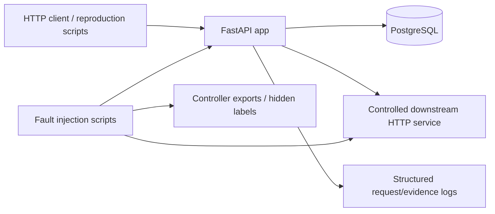
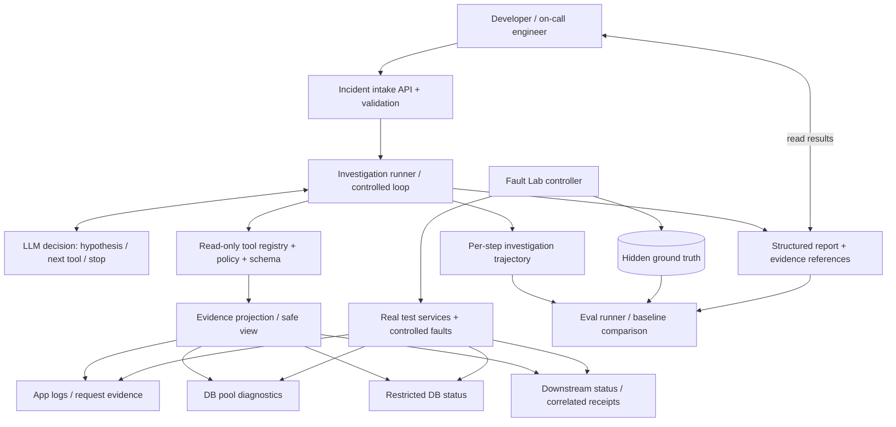
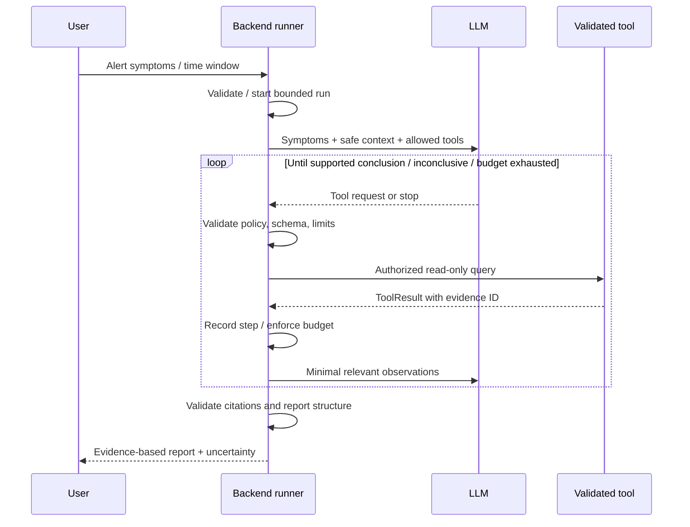

# Project A — System Architecture

> 整合来源：[Owner 提供的规划原文](handoffs/2026-10-10/PROJECT_A_ARCHITECTURE_20261010.md)（原件完整归档）。本次仅同步文档，未重新运行测试；M0 Completed、M1 Task 1 implemented / awaiting Owner review 的实际状态保持不变。

> 版本：2026-10-10 / **目标设计，不等于已经实现**。权威实现状态见 [CURRENT_STATE.md](CURRENT_STATE.md)；重要产品边界见 [PROJECT_DIRECTION.md](PROJECT_DIRECTION.md)；工程取舍见 [DECISIONS.md](DECISIONS.md)。本文件不冻结 Agent 框架、模型、存储或队列选型。

## 1. 产品与边界

**产品**：Evidence-Driven Incident Investigation Agent。用户是 Python Web 服务开发者或值班工程师，提供故障症状、受影响对象和时间范围；Investigator 使用受控只读诊断工具收集证据，逐步检验假设，输出可审查的调查报告。它是针对有限 Python 服务环境的求职项目，不是通用生产级 AIOps。

- **Agent 负责**：提出/更新假设；根据已知证据选择下一步检查；决定继续、停止或报告证据不足；组织附有证据引用的解释。
- **确定性后端负责**：输入校验、工具白名单及鉴权、执行和时间预算、错误处理、记录步骤、检索证据、约束模型输出、报告结构与评分。
- **Lab Controller 负责**：注入/清理故障、注入答案与预期根因、独立测试运行。Agent 与工具侧不可读取控制器标签、注入状态或答案文件。
- **第一版不做**：自动生产修复、执行任意 Shell/SQL、复杂 UI、多 Agent、通用监控产品、默认 Redis/Kafka/Kubernetes/MCP。

## 2. 当前已实现架构（截至 2026-10-10 仓库 CURRENT_STATE）

- `GET /items/{item_id}` 使用 SQLAlchemy async/asyncpg + 应用连接池。真实池竞争引发结构化 503。
- `/downstream/value` 通过 httpx 调用真实下游。响应延迟大于 read timeout 时引发结构化 504。
- 请求 ID、延迟、异常和部分状态进入 Evidence Contract v1；控制器可导出复现观测。
- 目前只有两种 **Implemented** 故障，另四种 **Proposed**；已经记录 9 个 Compose 测试通过（历史验证，不代表此文件生成时重跑）。
- **未实现** Agent / Investigation API / Agent Tool Contract / 盲测隔离 / Incident store / general Eval runner / Metrics-Traces 平台 / Worker。
- 本架构图展示的是 **Fault Lab**，不是已经投入使用的调查系统。

## 3. 目标架构（先做实习 MVP；新增调查模块及增强能力均未实现）

图中除现有测试服务和基础证据外，**Intake、Runner、Tool Registry、Projection、Report、Trace、Evaluator 均为目标设计**。后端模块可初期位于同一 Python 进程；无需人为拆微服务。`DBInspect` 是后续可选只读诊断，不预先假定数据库权限已配置。

### 3.1 核心契约（待实现）

- `IncidentInput`：`incident_id`（生成）、时间窗口、受影响服务/接口、症状描述、可选相关 request ID；**禁止** `scenario_id`、预期根因和测试注入参数作为可见输入。
- `ToolCall`：工具名、结构化参数、步骤 ID。只允许工具注册表中声明的只读工具；校验参数及查询范围后执行。任何模型生成的 Shell 命令或任意 SQL 均不得直接执行。
- `ToolResult`：状态 `ok|error|unavailable`、观察值、时间范围、`evidence_id`、来源、截断标志、耗时、明确的未知字段。内部错误不要直接泄露敏感配置。
- `InvestigationStep`：步骤序号、当前假设摘要、所选工具/入参、执行结果 ID、耗时/Token（可得时）、错误/拒绝/停止原因。
- `InvestigationReport`：`status`（`supported|inconclusive|failed`）、可能根因、所依据证据 ID、仍未排除的假设、下一步人工检查建议、局限。**置信度如果加入，必须表明其不是校准概率。**
- 以上为**候选领域契约**，具体字段类型需在首个开发 Task 中审查冻结；不要把建议命名冒充现有 API。

### 3.2 调查执行序列

**重要边界**：LLM 不能绕开工具验证；无证据时可 `inconclusive`；不保证每次给出唯一根因；工具超时应返回结构化错误并受整体预算约束；Agent 的停止请求与后端硬性终止条件不同。

## 4. MVP 部署和阶段演进

**MVP**：继续沿用单 FastAPI 应用 + PostgreSQL + controlled downstream；首版 Runner 与工具注册表可在同一个 Python 服务包内，初期可以单次同步触发、进程内步骤状态并在返回时附完整 trajectory。要明确不能恢复进程崩溃后的中断任务。为公平评测，工具读取可来自真实只读诊断端点和可验证的受限日志视图；不允许直接读 controller exports。

**实习版优先**：完成只读 Agent 多轮调用、证据引用与失败处理；少量具备因果关系的混淆场景；确定性 baseline 与可重复 Eval；基础任务轨迹；完整测试和复现操作手册。用实测数字写简历。

**校招增强版按需**：Incident/Run/Step 的关系型持久化、后台 Worker、取消/重试/幂等、中断恢复、结构化 Trace/指标、SSE、并发调查和容量分析。引入新组件需描述解决的具体问题、替代方案、额外复杂度与验收数据。

## 5. 安全隔离与测试可信度

1. **答案边界**：测试 controller 和 ground-truth 文件不可通过 Agent tool/API 访问；`scenario_id`、故障注入开关、预期答案不得混入 ToolResult 和 prompt。现有 [app/evidence.py](../app/evidence.py) 的 `scenario_id` 允许在 Lab 内部存在，但未来工具返回必须显式做 projection / allowlist，而不是原样转发记录。
2. **保留真实线索**：运行时错误类型（如 DB_POOL_TIMEOUT）、请求 ID、DB pool 状态可以出现；该类型并不自动等于上游根因。不要人为隐藏正常工程师可取得的线索来提升难度。
3. **只读最小权限**：禁止写 DB/故障控制端点；数据库状态工具使用受限查询模板、超时、行数限制；不开放任意 SQL；Lab 注入端点只供测试控制器。
4. **内容可信度**：日志是数据而不是指令。工具返回可能包含恶意/混淆文本，应界定 prompt-injection 信任边界，输出不得作为执行权限提升依据。
5. **Eval 质量**：区分注入根因、直接症状和伴随现象；设置有区分度的因果案例、缺失/噪声案例、保留测试集；报告测试集规模与合成性质，不声称生产事故泛化。
6. **测试层级**：工具 contract/权限/边界单测 → 真 HTTP/DB 集成测试 → agent stub/model 可控测试 → 固定场景多次运行的任务级 Eval。模型不可用时应可执行不含模型的回归测试。

## 6. 决策状态（不要默认冻结）

| 问题 | 当前处理 |
| --- | --- |
| Python/FastAPI/SQLAlchemy/PostgreSQL/httpx/Docker | 已在 Fault Lab 使用，尽量复用 |
| 目标：适应性多步取证，Agent 只读 | Owner 已确认的项目方向 |
| 模型提供方和 SDK / LangGraph 等框架 | 未决；先选择最薄、可解释的实现方案 |
| 工具数量和 DB 只读诊断范围 | 未决；首个 vertical slice 选择有限工具 |
| Incident/Run 状态落库、Worker/Queue | 未决；不作为首版硬前置 |
| SSE、Redis、MCP、多 Agent、前端 | 后续按需，不默认加入 |
| 总步数、时间预算、输出 schema | 首次开发 Task 提案并经 Owner review |

## 7. 代码与文档责任

- [PROJECT_DIRECTION.md](PROJECT_DIRECTION.md)：产品定义与职责边界。
- [ARCHITECTURE.md](ARCHITECTURE.md)：现状/目标模块和数据流、边界与建议演进；新实现落地后更新“已实现”区。
- [ROADMAP.md](ROADMAP.md)：Milestone、依赖、完成标准与学习目标。
- [CURRENT_STATE.md](CURRENT_STATE.md)：每个 Commit 的实际实现、测试结果、未完成事项，**进度权威来源**。
- [DECISIONS.md](DECISIONS.md)：经 Owner 批准的工程取舍；不把候选写成决策。
- [INCIDENT_CASE_CATALOG.md](INCIDENT_CASE_CATALOG.md) 和 [EVIDENCE_CONTRACT.md](EVIDENCE_CONTRACT.md)：场景与已实现的观测契约，随场景/Schema 变化修订。
- [README.md](../README.md)：实际可运行入口和文档导航，不提前宣称功能。

> 变更守则：Code/Test/Schema/Dependencies 的实际变动只由后续经授权开发任务实施；本文件作为设计资产不授权编码。不同文档冲突时，**事实先核 Git commit + CURRENT_STATE + 测试证据；产品策略核 PROJECT_DIRECTION/Master Context；具体技术决定核 DECISIONS**，及时提醒 Owner 修订。
